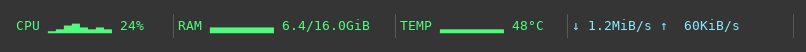
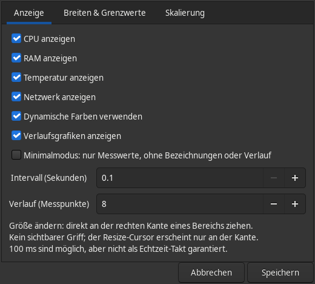
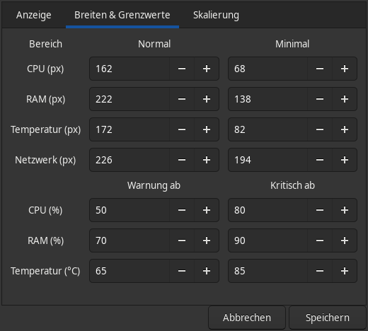
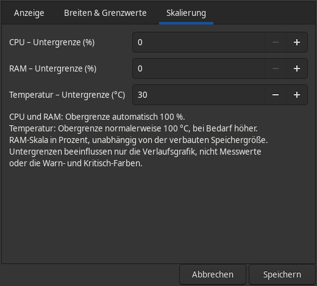

<div align="center">
  

  # SysRibbon

  **A lightweight, customizable system monitor for the Xfce panel.**

  Linux · Xfce · C11 · GTK 3 · MIT<br>
  **v0.5.0 — development preview**
</div>

SysRibbon shows live CPU, RAM, temperature and network statistics directly in your Xfce panel. It's a native C plugin — not a btop wrapper — and does not spawn a subprocess for each refresh.



Or activate **minimal mode**:


*Captured from the actual GTK plugin widgets with fixed demonstration values, using the Adwaita dark theme.*

> **Status:** Development preview. Sampler, presentation and GTK GUI tests pass locally; full desktop-session integration and Debian binary builds have not been validated on every target distro. Report bugs with distro, Xfce and panel versions.

## Features

- Live **CPU usage, memory, temperature and network throughput**
- Optional history sparklines, or snapshot-only display
- Minimal numeric-only mode
- Dynamic green/yellow/red thresholds (or no coloring)
- Stable section widths, resizable via dragging section boundaries
- Separate widths for regular and minimal mode
- Configurable graph floors (CPU/RAM percentages; temperature °C)
- Update interval from **100 ms to 15 s** (not hard real-time)
- Native `/proc` and `/sys` reads; no Python, btop or monitoring daemon
- Per-plugin-instance settings saved using Xfce's configuration files

**Default graph range:** CPU/RAM 0–100%; temperature 30–100 °C, with an automatically increasing upper bound when necessary. RAM graphs scale to each machine's total RAM; they do not assume a fixed amount of memory.

## Requirements

Linux with **Xfce Panel / libxfce4panel-2.0** and GTK 3. This is *not* a GNOME or KDE extension.

## Install on Ubuntu / Xubuntu / Debian

### Option A: Build an APT-managed `.deb` (recommended for testing)

Install the build dependencies:

```sh
sudo apt update
sudo apt install build-essential pkg-config debhelper devscripts dpkg-dev fakeroot \
  libgtk-3-dev libxfce4ui-2-dev libxfce4panel-2.0-dev libxfce4util-dev
```

Clone this repository or unpack the source archive and enter its root directory:

```sh
git clone https://github.com/BlackmillSolutions/sysribbon.git
cd sysribbon
./tools/build-deb.sh
```

Install the resulting file from the **parent directory** (the architecture portion may differ):

```sh
sudo apt install ../xfce4-sysribbon-plugin_0.5.0-1_*.deb
xfce4-panel -r
```

This registers the package with APT, so removal is later simply:

```sh
sudo apt remove xfce4-sysribbon-plugin
```

> **Local `.deb` ≠ official repository listing.** You can install a local `.deb` through `apt`, but `sudo apt install xfce4-sysribbon-plugin` **without a file path** works only after a repository that APT knows about actually publishes the package. See [PACKAGING.md](PACKAGING.md).

### Option B: Build and install from source

Install the GTK/Xfce development dependencies (listed above), then:

```sh
make test
make
sudo make install
xfce4-panel -r
```

To uninstall this *manually installed* copy from the same directory:

```sh
sudo make uninstall
xfce4-panel -r
```

**Avoid mixing** an unmanaged `sudo make install` copy with the `.deb` package. Prefer APT for future updates.

### Add to the panel

Right-click an Xfce panel → **Panel → Add New Items** → **SysRibbon**. Right-click SysRibbon → **Properties** to configure it.

## Configuration

| Settings area | What you can change |
| --- | --- |
| Display | Visible metrics, update interval, history length, colors, sparklines, minimal mode |
| Widths & thresholds | Section widths (normal/minimal), warning and critical thresholds |
| Scaling | Lower bounds for CPU, RAM and temperature history graphs |

Drag each section's **right edge** to resize it; the resize cursor should appear only near its edge. Values are not clickable and **do not launch btop**.

<details>
<summary>Settings screenshots (current interface in German)</summary>

**Display**



**Widths and thresholds**



**Scaling**



</details>

## Design and performance

| Metric | Data source |
| --- | --- |
| CPU | `/proc/stat` delta counters |
| RAM | `/proc/meminfo` |
| Network | `/proc/net/route`, `/proc/net/dev` |
| Temperature | `/sys/class/hwmon`, `/sys/class/thermal` |

A GLib timer drives updates. History is bounded in memory. Disabled metrics are skipped, and temperature is sampled no more often than approximately every 250 ms. A 100-ms timer is best-effort and will be affected by system load.

## Known limitations

- The default IPv4 network interface is used; IPv6-only and complex routing setups are not yet comprehensively supported.
- Temperature reporting requires kernel-exposed sensors.
- The first CPU/network sample establishes a baseline.
- Some Xfce versions and vertical panel configurations need more hands-on UI testing.
- Debian packaging is provided for local builds and future upstream review; **the package has not been accepted into Debian or Ubuntu repositories**.

## Development and GUI tests

```sh
make test        # Sampler, formatting and graph scale tests
make             # Build the panel plugin
```

The GTK GUI suite additionally needs Python 3, Xvfb and a D-Bus session runner:

```sh
sudo apt install python3 xvfb dbus-daemon
make test-gui
make screenshots # Run the suite and capture PNGs in assets/screenshots/
```

The runner creates a private X11 display, session bus and configuration directory.
It does not restart or modify your desktop panel. Set `XVFB=/path/to/Xvfb` to use
an Xvfb executable outside `PATH`.

GUI tests compile the production plugin and exercise its real GTK widgets and
Xfce configuration files in a GTK host window. Only sampling is replaced with
fixed demonstration values, keeping screenshots reproducible and independent of
the host's sensors. Coverage includes default rendering, minimal mode, saving
and reloading settings, cancellation, hiding and restoring metrics, threshold
normalization, horizontal and vertical resizing, timer updates and missing
sensors. Full desktop-session integration still needs testing in Xfce.

## Maintainers and contributors

Pull requests, bug reports and reproducible test cases welcome. For panel issues, include your Linux distribution, Xfce version, panel orientation and steps to reproduce.

**Packaging/release maintainers:** Before publishing packages, replace the template name, email and GitHub URL in `debian/control`, `debian/changelog`, `debian/copyright` and this README. See [PACKAGING.md](PACKAGING.md).

## License

MIT — see [LICENSE](LICENSE).
